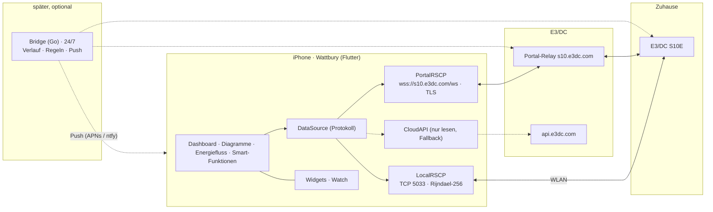

# 02 · Architektur

Entscheidung 24.10.2026: **Die App spricht direkt mit dem Hauskraftwerk**, so wie my4E. Keine Bridge im Kern, keine Zugangsdaten außerhalb des iPhones. Eine Bridge bleibt ein optionales Zusatzmodul für Benachrichtigungen und Langzeitverlauf und wird in Datenmodell und API von Anfang an vorgesehen.

## Überblick

## Verbindungslogik in der App

Reihenfolge wie bei my4E, automatisch gewählt und in der Kopfzeile sichtbar („RSCP lokal · 1 s“, „RSCP Portal · 3 s“, „Cloud · 15 s“):

1. **Lokal** (im WLAN): TCP 5033, Rijndael-256-CBC, Portal-Login + RSCP-Passwort. Schnellstes Intervall (1 s), alle Setter.
2. **Portal-Tunnel** (überall): Websocket-Relay, Portal-Login + Seriennummer, siehe [04-portal-tunnel](04-portal-tunnel.md). Intervall 2–5 s, um E3/DC-Server zu schonen. Setter nach Test.
3. **Cloud-API** (nur lesen): Fallback, wenn beides ausfällt. 15 s live, 15 min Verlauf.

Beide RSCP-Transporte teilen sich einen **TLV-Codec** (Tag, Typ, Länge, Wert; Container verschachtelt; Frame mit Magic `E3DC`, Zeitstempel, Länge, optional CRC; beim Portal zusätzlich der kompakte 8-Byte-Header und das Spiegeln von `RSCP_REQ_SET_PROTOCOL_VERSION`). Der Codec ist der Kern der Arbeit und wird als eigenes Dart-Paket `openrscp` mit Tests gebaut, Tag-Tabelle aus `go-rscp`/`python-e3dc` generiert.

## App-Schichten

| Schicht | Inhalt |
|---|---|
| `openrscp` (Dart-Paket, eigenes Repo) | TLV-Codec, Tag-Enum, Rijndael-256 (CBC, 32-Byte-Block, IV-Verkettung), Frame-Reassembly, Websocket-Relay-Handshake, Auth-Level. Reine Logik, ohne UI, mit Tests gegen aufgezeichnete Frames. |
| `DataSource` | Protokoll mit `live()`, `system()`, `battery()`, `pv()`, `history(range)`, `settings()`, `set…()`; Implementierungen Local, Portal, Cloud. Automatische Wahl + Reconnect. |
| `Store` | SQLite (drift) auf dem Gerät: Tageswerte und Monatswerte aus der S10-DB zwischengespeichert, damit Diagramme sofort erscheinen; Einstellungen; Änderungsprotokoll der Setter. |
| `Features` | Energiemonitor, Diagramme, Energiefluss, Smart-Funktionen, Wallbox, Systemstatistik, Einstellungen (Screens aus dem Click-Dummy). |
| `Services` | Prognose (Open-Meteo, optional Solcast mit eigenem Key; gelernter Korrekturfaktor aus der S10-Datenbank), Tibber/aWATTar (optional), Tarif/Kosten-Rechnung. |
| `Widgets` / `Watch` | WidgetKit-Timeline (nativer Swift-Teil, über `home_widget` angebunden) (alle 15 min ein kurzer Portal-Abruf), Watch-App „Jetzt“. |
| `Notifications` (vorgesehen) | Regel-Modell und UI jetzt, Versand später über die Bridge. Ohne Bridge: lokale Hinweise nur, solange die App offen ist. |

## Vorbereitung für die spätere Bridge

Damit die Bridge später ohne Umbau andocken kann:

- `DataSource` bekommt von Anfang an eine vierte Implementierung `BridgeAPI` (REST + WebSocket, Token), zunächst ungenutzt.
- Regeln für Benachrichtigungen (SOC unter x %, Netzbezug über x kW für n Minuten, offline, Temperatur) werden als Datenmodell und Einstellungs-UI angelegt; der Schalter „über Bridge senden“ bleibt ausgegraut, bis eine Bridge eingetragen ist.
- Verlaufsdaten werden in einem bridge-kompatiblen Schema abgelegt (Buckets mit `ts`, `solar`, `haus`, `netz_in`, `netz_out`, `bat_in`, `bat_out`, `wb`, `soc`), so dass die Bridge dieselben Tabellen nur feiner füllt.
- Die Bridge selbst (Go, SQLite, zwei RSCP-Transporte, Push über APNs oder ntfy) ist in [04-portal-tunnel](04-portal-tunnel.md) und der ersten Fassung dieses Dokuments beschrieben und wird erst gebaut, wenn Benachrichtigungen oder Langzeitverlauf gewünscht sind.

## Sicherheit

- Portal-Login, RSCP-Passwort und Seriennummer liegen nur im iOS-Schlüsselbund.
- Portal-Passwort wird als MD5 übertragen (Vorgabe des Relays), lokal als Rijndael-Schlüssel benutzt.
- Setter werden zurückgelesen und protokolliert; `EMS_REQ_SET_POWER` (nicht persistent) wird nicht als Dauerfunktion angeboten.
- Keine Daten an Dritte außer den bewusst konfigurierten Diensten (Open-Meteo oder Solcast für die Prognose, Tibber/aWATTar).

## Roadmap

| Phase | Inhalt | Ergebnis |
|---|---|---|
| 0 | Konzept, Click-Dummy, Farbwelt Signal, Tunnel-Recherche | abgeschlossen |
| 1 | Tunnel-Test mit `tools/portal-tunnel-test.py` (Lesen, Latenz, ein harmloser Setter) | Klarheit über Reichweite des Tunnels |
| 2 | `openrscp`: TLV-Codec + Portal-Transport + Tests; Flutter-Projekt, Design-Tokens aus dem Click-Dummy, Verbindungs-Assistent, Live-Werte (Linux-Fenster, Android, iOS via TestFlight) | Erste lauffähige App |
| 3 | Lokaler Transport (Rijndael), automatische Wahl; Energiemonitor komplett, Energiefluss | my4E-Grundumfang |
| 4 | Diagramme aus der S10-DB mit Zwischenspeicher, Prognose, Kosten; Smart-Funktionen und Wallbox mit Rücklesen | my4E-Premium-Umfang |
| 5 | Widgets, Watch, Benachrichtigungs-Regeln als UI | Komfort |
| 6 (optional) | Bridge für Push und Langzeitverlauf | Mehr als my4E |
